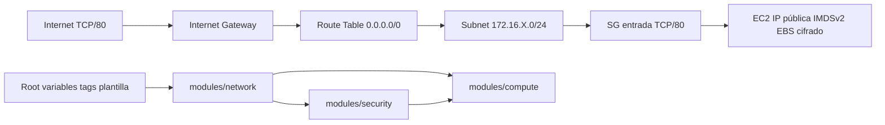

# NexoAndes — Fase 1 — Portal Operacional V1

Evaluación Sumativa U1 · Automatización de Infraestructura con IaC (IC106TICL) · Instituto Profesional San Sebastián.

Repositorio individual: https://github.com/JoacoZun/nexoandes-iac-u1

Implementación modular para laboratorio AWS. **No hay despliegue real, portal comprobado, PR ni aprobación registrados.** No es posible declarar 100/100 sin esas evidencias. Consulte [resultados reales](docs/VALIDATION.md), [matriz CE1–CE8](docs/RUBRIC.md) y [plan de evidencias](docs/EVIDENCE.md).

## Arquitectura y estructura



El diagrama representa conectividad lógica; una tabla de rutas no filtra tráfico. VPC fija `172.16.0.0/16`; `cidrsubnet(..., 8, X)` garantiza `172.16.X.0/24`. Se valida X entero en [0,255]; el número real sigue pendiente.

| Ruta | Responsabilidad |
|---|---|
| Root: main, variables, outputs | Composición, validaciones, contrato de entrada/salida |
| versions, providers, lock | Restricciones, región explícita, versión y hashes reproducibles |
| modules/network | VPC, subnet, IGW, tabla, ruta y asociación |
| modules/security | SG, entrada HTTP y salida HTTP/HTTPS |
| modules/compute | AMI, EC2, bootstrap, IMDSv2 y volumen raíz |
| templates | Integración pendiente de plantilla oficial |
| tests | Aserciones Terraform con AWS mock, sin credenciales |
| .github/workflows/ci.yml | Cinco controles sin AWS |
| .github/workflows/deploy.yml.disabled | Candidato de despliegue inerte |
| ci | Adaptadores institucionales explícitamente bloqueados |
| scripts y docs | Controles, operación, PR, verificación y entrega |

IDs transmitidos por outputs: network → security/compute y security → compute. La dependencia adicional de compute espera rutas y reglas de salida para arrancar con conectividad.

## Versiones, seguridad y límites

Terraform probado localmente con 1.16.6; lenguaje >=1.7 (mocks) y <2. AWS Provider `~> 6.42.0` fija la serie 6.42; el lock fija versión y hashes reales. Actualizar requiere PR y repetir controles. La guía institucional no se ha recibido.

AMI predeterminada consultada a Amazon: AL2023 EBS/HVM x86_64. Si la guía exige otra, proporcionar `ami_id` de la región autorizada y confirmar compatibilidad con script/tipo EC2. `most_recent` puede cambiar entre planes: registrar/preservar el ID aprobado para reconstrucción exacta. No se asume región ni tipo EC2 de despliegue.

Sin SSH, key pair, rol IAM EC2 ni credenciales en código. Entrada solo TCP/80 público. Salida TCP/80 y TCP/443 para repositorios; SG stateful permite respuestas sin abrir puertos efímeros. DNS utiliza AmazonProvidedDNS, cuyo tráfico no filtra el SG. Revisar necesidades al recibir la plantilla. HTTP e IPv4 pública son exposiciones requeridas. EC2/EBS/IPv4 pueden tener costo; no se presupone Free Tier.

## Cinco controles sin AWS

```powershell
terraform init -backend=false -input=false -lockfile=readonly
terraform fmt -check -recursive
terraform validate
terraform test
tflint --init
tflint --recursive
./.tools/python/python.exe -m checkov.main --config-file .checkov.yml
./.venv/Scripts/python.exe -m unittest discover -s tests -p 'test_*.py' -v
./.venv/Scripts/python.exe scripts/check_repository.py
```

Los `apply` de `terraform test` usan exclusivamente `mock_provider "aws"`. Los datos sintéticos de pruebas no autorizan región/tipo EC2 de despliegue. La fixture no implementa el portal.

En este equipo la política de Windows PowerShell bloqueó `.ps1`. Se comprobó la previsualización usando `powershell.exe -NoProfile -ExecutionPolicy RemoteSigned -File scripts/Build-Submission.ps1 -Preview`, limitado a ese proceso y sin cambiar la política global. Para el runner local se puede usar el mismo prefijo con `scripts/Invoke-Checks.ps1`. Esto no soluciona el bloqueo mTLS del provider registrado en `docs/VALIDATION.md`; no desactivar TLS para intentar validar.

El `.venv` existente usa Python 3.13 y `requirements-repository.txt` (python-hcl2 8.1.4 y PyYAML 6.0.3). No recrearlo: si faltan dependencias, usar `.venv\Scripts\python -m pip install -r requirements-repository.txt`. Checkov conserva el Python 3.12 existente en `.tools/python/` y el CI usa `requirements-ci.txt`, que declara su fork bc-python-hcl2 0.4.3. **No instalar ambos conjuntos en un mismo entorno:** ambos parsers distribuyen el módulo `hcl2`. El verificador y sus 20 regresiones se prueban en los dos entornos; CI mantiene jobs separados para ellos.

TFLint 0.61.0 utiliza el plugin AWS 0.40.0 fijado en `.tflint.hcl`. Si no está en PATH, usar `.tools/tflint/tflint.exe` en los comandos anteriores. Antes de init, fijar `$env:TFLINT_PLUGIN_DIR = Join-Path $PWD '.tools/tflint-plugins'` para mantener plugins en el proyecto. Dependencias principales fijadas; las transitivas de pip se resuelven al instalar, por lo que no se afirma entorno hermético. `scripts/Invoke-Checks.ps1` prefiere `.venv` para las regresiones/verificador, mantiene Checkov en Python 3.12 y registra PASS/FAIL/NOT_RUN en `artifacts/checks/`, excluido de Git.

Checkov ejecuta cinco políticas seleccionadas: cifrado EBS, descripción SG, ausencia de SSH/RDP público e IMDSv2. El resultado se limita a ese perfil. La política local adicional rechaza entradas extra y claves SSH. Un escaneo del catálogo completo puede mostrar hallazgos fuera de alcance que se deben revisar y justificar; no se han ocultado mediante `soft-fail`. En particular, CKV_AWS_260 exige cerrar HTTP público, incompatible con el diagrama obligatorio de esta Fase 1.

## Configuración pendiente antes del plan real

Confirmar número de lista, identificador/nombre del estudiante, región, tipo EC2 permitido, AMI/SO y plantilla original. También guía de CI/CD, autenticación temporal, cuenta autorizada y backend cifrado con locking.

Crear localmente `lab.auto.tfvars` (ignorado) con valores reales autorizados:

```hcl
# Completar sin copiar marcadores como valores:
# aws_region = ...
# list_number = ...
# student_id = ...
# instance_type = ...
# ami_id = ... # opcional; null consulta AL2023
user_data_template_path = "templates/user_data_v1.sh.tpl"
portal_parameters       = {} # adaptar al contrato oficial
```

No ejecutar plan real con archivo incompleto. Plantilla ausente, vacía o con error de renderizado bloquea EC2. Autenticidad y funcionamiento se revisan aparte; ver [contrato](templates/README.md).

No hay backend ficticio. El backend local actual sirve solo para validar; no usarlo en runners efímeros. `init -backend=false` no configura state remoto. Los adaptadores `ci/` deben incorporar autenticación/backend autorizados antes de activar despliegue. Mantener state, planes y variables privadas fuera de Git, incluso después de destroy.

## Operación y entrega

[Pipeline y gate](docs/PIPELINE.md) · [Verificación y limpieza](docs/OPERATIONS.md) · [Git y PR](docs/PULL_REQUEST.md) · [Evidencias y EVA](docs/EVIDENCE.md).

No ejecutar apply/destroy sin autorización explícita. No se crean commits, pushes, merges o PR automáticamente. ZIP/PDF finales requieren identificación y evidencias completas. El script de ZIP filtra extensiones/rutas y exige además revisión humana de secretos.

## Referencias y apoyo (APA 7)

HashiCorp. (s. f.). *Provider mocking*. https://developer.hashicorp.com/terraform/language/tests/mocking

HashiCorp. (s. f.). *AWS Provider 6.42.0*. https://registry.terraform.io/providers/hashicorp/aws/6.42.0/docs

GitHub. (s. f.). *Managing environments for deployment*. https://docs.github.com/en/actions/how-tos/deploy/configure-and-manage-deployments/manage-environments

Palo Alto Networks. (s. f.). *Checkov CLI command reference*. https://www.checkov.io/2.Basics/CLI%20Command%20Reference.html

Amazon Web Services. (s. f.). *Security group rules*. https://docs.aws.amazon.com/vpc/latest/userguide/security-group-rules.html

Referencias consultadas el 24 de octubre de 2026. ChatGPT/Codex se utilizó para apoyar generación, revisión y validación de código y documentación. El estudiante debe comprender, revisar y asumir responsabilidad por decisiones/resultados. No se atribuyen despliegues ni evidencias inexistentes.
